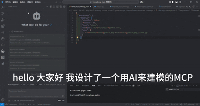
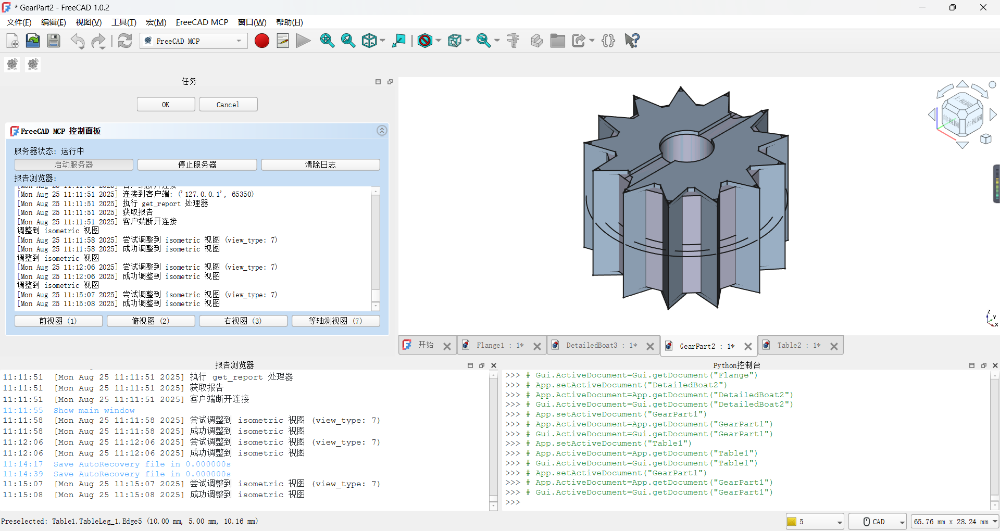
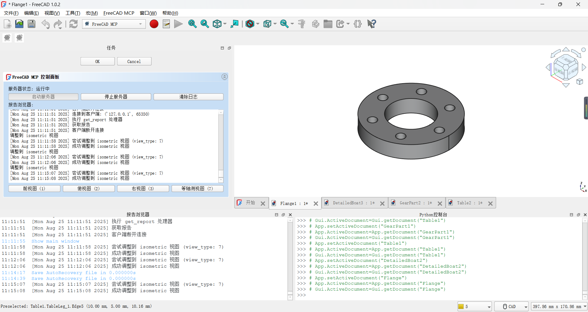
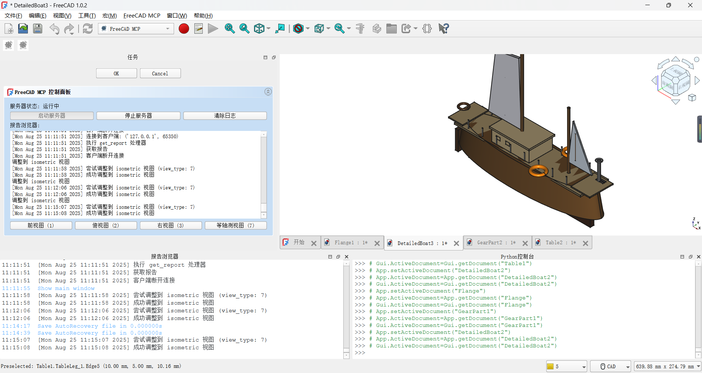
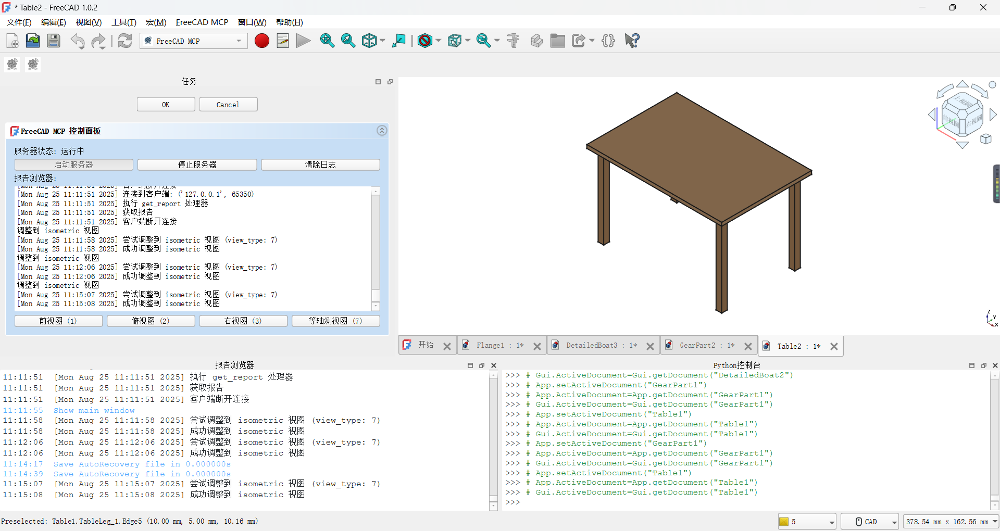

# FreeCAD MCP Plugin

The **FreeCAD MCP** plugin integrates the **Model Control Protocol (MCP)** into FreeCAD, enabling automation of model creation, macro execution, and view management through a server-client architecture. It provides a GUI control panel and a command-line client to streamline FreeCAD workflows, supporting tasks like creating/running macros, adjusting views, and integrating with external tools (e.g., Claude, Cursor, Trace, CodeBuddy).


## Table of Contents

- [Features](#features)
- [Quick Start](#quick-start)
- [Installation](#installation)
- [Windows / FreeCAD 1.x Compatibility Notes (local fork)](#windows--freecad-1x-compatibility-notes-local-fork)
- [MCP Configuration](#mcp-configuration)
- [Usage](#usage)
- [Tool Functions](#tool-functions)
- [Use Cases](#use-cases)
- [External Tool Integration](#external-tool-integration)
- [Assets](#assets)
- [Troubleshooting](#troubleshooting)
- [Contributing](#contributing)
- [License](#license)

## Features

The FreeCAD MCP plugin (v0.1.0) offers the following features:

- **MCP Server**: Provides a GUI control panel (`FreeCADMCPPanel`) and processes commands like `create_macro`, `update_macro`, `run_macro`, `set_view`, and `get_report` (implemented in `freecad_mcp_server.py`).
- **MCP Client**: Command-line tool to send commands via `stdio` or TCP, manage `.FCMacro` files (create, update, run, validate), and control FreeCAD remotely (implemented in `freecad_mcp_client.py`).
- **Single-command CLI**: With arguments (`--create-macro`, `--run-macro`, `--get-report`, …) the client sends one request and prints the JSON reply; without arguments it runs as the stdio MCP server.
- **Macro Normalization**: Automatically adds imports (`FreeCAD`, `FreeCADGui`, `Part`, `math`) and post-execution steps (recompute, view adjustment) for macros.
- **GUI Control Panel**: Includes buttons to start/stop the server, clear logs, and switch views (front, top, right, axonometric).
- **Logging System**: Records messages and errors to `freecad_mcp_log.txt` in the temporary directory (e.g., `%TEMP%\freecad_mcp_log.txt`) and a GUI report browser (100-line limit).
- **Workbench Integration**: Adds a `FreeCADMCPWorkbench` with toolbar and menu commands (implemented in `InitGui.py`).
- **Visual Assets**: Includes workbench icon (`icon.svg`), example models (`gear.png`, `flange.png`, `boat.png`, `table.png`), and demo animation (`freecad.gif`, `freecad.mp4`).

Watch the demo animation:

Download the demo video: [FreeCAD MCP Demo MP4](assets/freecad.mp4)

## Quick Start

1. Install the plugin (see [Installation](#installation)) and its Python dependency.
2. Launch FreeCAD, switch to the `FreeCAD MCP` workbench and click `启动MCP服务器`
   (`Start Server`). The server must stay running; it listens on `localhost:9876`.
3. Use the client in single-command mode from a shell, or let an MCP client
   (Claude Code, Cursor, …) call the tools:
   ```bash
   python <addon>\src\freecad_mcp_client.py --create-macro gear --template-type part
   python <addon>\src\freecad_mcp_client.py --update-macro gear --code "radius = 15\ngear = Part.makeCylinder(radius, 5)\nPart.show(gear)"
   python <addon>\src\freecad_mcp_client.py --run-macro gear.FCMacro
   ```
4. View the result: the gear model is created and the view switches to axonometric.

> `<addon>` below is the installed addon folder, e.g.
> `%APPDATA%\FreeCAD\v1-1\Mod\FreeCAD-MCP` (see [Installation](#installation)).

## Installation

### Prerequisites

- **FreeCAD**: Version 0.21 or higher; tested with **1.1.4** (Qt6 / PySide6).
- **Python**: Version 3.10+. FreeCAD's bundled interpreter (`<FreeCAD>\bin\python.exe`) works fine.
- **Python dependencies**:
  ```bash
  pip install "mcp>=1.2,<2" httpx
  # or, from the repository root:
  pip install -e .
  ```
  **Note**: `mcp` 2.x is not supported — the FastMCP API used by the client was removed in 2.0.

### Installation Steps

1. **Clone the Repository** (or your fork):
   ```bash
   git clone https://github.com/ATOI-Ming/FreeCAD-MCP.git
   ```

2. **Put it in the FreeCAD Mod Directory**:
   - Windows, FreeCAD 1.x: `%APPDATA%\FreeCAD\<version>\Mod\FreeCAD-MCP`
     (e.g. `v1-1`; FreeCAD 1.x creates a version subdirectory — the plain
     `%APPDATA%\FreeCAD\Mod` is not scanned by 1.x)
   - Windows, FreeCAD 0.21: `<FreeCAD install>\Mod\FreeCAD-MCP`
   - Linux: `~/.local/share/FreeCAD/<version>/Mod/FreeCAD-MCP`
   - macOS: `~/Library/Application Support/FreeCAD/<version>/Mod/FreeCAD-MCP`
   ```bash
   # Windows example (cmd.exe)
   xcopy FreeCAD-MCP "%APPDATA%\FreeCAD\v1-1\Mod\FreeCAD-MCP" /E /H /C /I
   ```
   For development, a directory junction avoids copying after every change:
   ```cmd
   mklink /J "%APPDATA%\FreeCAD\v1-1\Mod\FreeCAD-MCP" C:\path\to\FreeCAD-MCP
   ```
   The folder must contain `InitGui.py` and `package.xml` at its root.

3. **Launch FreeCAD**:
   - Switch to the `FreeCAD MCP` workbench using the workbench dropdown in the top
     toolbar. The `FreeCAD MCP` menu and toolbar only appear after the workbench is
     activated (they are not in the Tools menu).

4. **Verify Installation**:
   - Click `启动MCP服务器` (`Start Server`).
   - Check `%TEMP%\freecad_mcp_log.txt` for a "服务器启动于 localhost:9876" message,
     then run `python <addon>\src\freecad_mcp_client.py --get-report`.

## Windows / FreeCAD 1.x Compatibility Notes (local fork)

FreeCAD 1.x (tested with 1.1.4 on Windows 11) required these changes:

- **Qt6 / PySide6**: `freecad_mcp_server.py` and `InitGui.py` import PySide6 with a PySide2 fallback.
  FreeCAD 1.x ships Qt6, so the original `PySide2`-only imports failed to load.
- **InitGui execution namespace**: FreeCAD runs `InitGui.py` via `exec(code, globals, locals)`, so
  module-level names are invisible inside class bodies/methods (and `__file__` is undefined).
  Resolved paths are published into `globals()` and bound as default arguments.
- **Versioned user directories**: FreeCAD 1.1 uses `%APPDATA%\FreeCAD\v1-1\Mod` and
  `%APPDATA%\FreeCAD\v1-1\Macro`. Relative macro names are now resolved by the FreeCAD-side
  server instead of being turned into a hardcoded absolute path by the client.
- **Server lifetime**: the toolbar command previously created the server as a local variable, so
  Python garbage-collected it and closed the listening socket immediately. `start_server()` now
  keeps a module-level singleton.
- **MCP SDK**: requires `mcp>=1.2,<2`; FastMCP was removed in mcp 2.x.
- **stdio encoding**: stdout/stderr are forced to UTF-8. Windows defaults to GBK, which corrupts
  the JSON-RPC stream whenever a message contains non-ASCII text.
- **Panel failure**: `get_report` falls back to `%TEMP%\freecad_mcp_log.txt` if the GUI panel
  cannot be created.

Local layout used during development:

- Source: `C:\Users\jimol\workspace\FreeCAD-MCP`
- Addon install: directory junction `%APPDATA%\FreeCAD\v1-1\Mod\FreeCAD-MCP` -> source
- Python env: `.venv` created from FreeCAD's bundled Python 3.11 (`<FreeCAD>\bin\python.exe`)
- Claude Code (user scope): `claude mcp add --scope user freecad -- <repo>\.venv\Scripts\python.exe <repo>\src\freecad_mcp_client.py`
- Usage: start FreeCAD, switch to the `FreeCAD MCP` workbench, click `启动MCP服务器` — tools only
  work while that server is listening on `localhost:9876`.

## MCP Configuration

Configure the MCP client to communicate with FreeCAD via `stdio` or TCP.

1. **Register the MCP Server**: the client script itself is the MCP stdio server; use a
   Python interpreter that has `mcp` installed (a virtualenv is recommended).

   [Claude Code](https://claude.com/claude-code):
   ```bash
   claude mcp add --scope user freecad -- <python> <addon>\src\freecad_mcp_client.py
   ```

   Generic `mcp.json` form (Claude Desktop / Cursor / other clients):
   ```json
   {
       "mcpServers": {
           "freecad": {
               "type": "stdio",
               "command": "C:\\path\\to\\python.exe",
               "args": ["C:\\path\\to\\FreeCAD-MCP\\src\\freecad_mcp_client.py"],
               "timeout": 60
           }
       }
   }
   ```
   **Note**: `command` only needs `mcp` — FreeCAD is not imported by the client. Paths may
   point to the addon folder or to a development checkout. For TCP communication instead of
   stdio, set `"type": "tcp"`, `"host": "localhost"`, `"port": 9876`.

2. **Run the Server** (inside FreeCAD):
   - The server must run in the FreeCAD GUI: `freecad_mcp_server.py` imports
     `FreeCAD`/`FreeCADGui`, so starting it with a plain `python` fails.
   - In the `FreeCAD MCP` workbench, click `启动MCP服务器` (`Start Server`), or run this in
     FreeCAD's Python console (`View → Panels → Python console`):
     ```python
     import sys
     sys.path.append(r"<addon>")
     import freecad_mcp_server as m
     m.start_server()
     ```
   - Keep FreeCAD open with the server running; closing FreeCAD stops the server.

3. **Verify Server**:
   - Check `%TEMP%\freecad_mcp_log.txt` for a "服务器启动于 localhost:9876" message.
   - Test a client command:
     ```bash
     python <addon>\src\freecad_mcp_client.py --get-report
     ```

## Usage

### GUI Usage

1. In FreeCAD, switch to the `FreeCAD MCP` workbench (icon: `assets/icon.svg`).
2. Click `FreeCAD_MCP_Show` to open the control panel (`FreeCADMCPPanel`).
3. Use the control panel:
   - **Start/Stop Server**: Control the MCP server.
   - **Clear Logs**: Clear the report browser and `%TEMP%\freecad_mcp_log.txt`.
   - **View Switching**: Select front, top, right, or axonometric views.
4. Run a macro: use the client (`--run-macro`) or an MCP tool call. There is no separate
   "Run macro" button; macros run through the server with automatic normalization.

### Command-Line Usage

With arguments, the client sends one command over TCP and prints the JSON reply; without
arguments it runs as the stdio MCP server. Use a Python that has `mcp` installed.

```bash
python <addon>\src\freecad_mcp_client.py <command>
```

| Command | Example |
|---------|---------|
| Create macro | `--create-macro my_macro --template-type part` |
| Update macro | `--update-macro my_macro --code "radius = 10\nPart.show(Part.makeBox(radius, radius, radius))"` |
| Run macro | `--run-macro my_macro.FCMacro --params '{"doc_name": "MyDoc"}'` |
| Validate code | `--validate-macro-code my_macro` or `--validate-macro-code --code "print(1)"` |
| Set view | `--set-view '{"view_type": "7"}'` |
| Get report | `--get-report` |

Notes:
- Relative macro names (`my_macro.FCMacro`) are resolved by the FreeCAD-side server against
  FreeCAD's own (versioned) macro directory; absolute paths are also accepted.
- `--code` treats a literal `\n` as a newline, so one-line examples work in cmd/PowerShell/bash.
- `--host` / `--port` select another server (default `localhost:9876`).
- Exit code is `0` when the reply reports `"result": "success"`, otherwise `1`.

## Tool Functions

The following tool functions are provided by `freecad_mcp_client.py`, sending commands via `stdio` or TCP (`localhost:9876`), processed by `freecad_mcp_server.py`.

| Function              | Parameters                              | Description                                                          |
|-----------------------|-----------------------------------------|----------------------------------------------------------------------|
| `create_macro`        | `macro_name`, `template_type`           | Creates an `.FCMacro` file, validates name (letters, numbers, underscores, hyphens), supports templates (`default`, `basic`, `part`, `sketch`). |
| `update_macro`        | `macro_name`, `code`                    | Updates macro content, auto-adds `FreeCAD`, `FreeCADGui`, `Part`, `math` imports. |
| `run_macro`           | `macro_path`, `params` (optional)       | Runs a macro; relative names are resolved by the server against FreeCAD's macro dir. Normalizes code, recomputes the document, adjusts to axonometric view. |
| `validate_macro_code` | `macro_name` (optional), `code` (optional) | Validates macro code syntax, returns success or error (with traceback). |
| `set_view`            | `params` (e.g., `{"view_type": "7"}`)  | Sets view: `1` (front), `2` (top), `3` (right), `7` (axonometric).   |
| `get_report`          | None                                    | Retrieves server logs (report browser, falling back to `%TEMP%\freecad_mcp_log.txt`). |

### Examples

- **Create Macro**:
  ```bash
  python <addon>\src\freecad_mcp_client.py --create-macro gear --template-type part
  ```
  Output: `{"status": "success", "result": "Macro created"}`

- **Update Macro**:
  ```bash
  python <addon>\src\freecad_mcp_client.py --update-macro gear --code "import FreeCAD, Part\nradius = 10\ngear = Part.makeCylinder(radius, 5)\nPart.show(gear)"
  ```
  Output: `{"status": "success", "result": "Macro updated"}`

- **Run Macro**:
  ```bash
  python <addon>\src\freecad_mcp_client.py --run-macro gear.FCMacro --params '{"radius": 15}'
  ```
  Output: `{"status": "success", "result": {...}}`

- **Validate Code**:
  ```bash
  python <addon>\src\freecad_mcp_client.py --validate-macro-code gear --code "import FreeCAD\nApp.newDocument()"
  ```
  Output: `{"status": "success"}`

- **Set View**:
  ```bash
  python <addon>\src\freecad_mcp_client.py --set-view '{"view_type": "7"}'
  ```
  Output: `{"status": "success", "result": "view set to axonometric"}`

- **Get Report**:
  ```bash
  python <addon>\src\freecad_mcp_client.py --get-report
  ```
  Output: `{"status": "success", "result": {...}}`

## Use Cases

1. **Automated Gear Model Creation**:
   - **Scenario**: Generate a parametric gear model for engineering design.
   - **Steps**:
     1. Create macro: `--create-macro gear --template-type part`
     2. Update macro: `--update-macro gear --code "import FreeCAD, Part\nradius = 15\ngear = Part.makeCylinder(radius, 5)\nPart.show(gear)"`
     3. Run macro: `--run-macro gear.FCMacro --params '{"radius": 15}'`
   - **Result**: Gear model generated, displayed in axonometric view.
   - **Output**:
     

2. **Generating a Flange Model**:
   - **Scenario**: Automate creation of a flange with holes for mechanical design.
   - **Steps**: Run macro: `--run-macro flange.FCMacro`
   - **Result**: Flange model generated with automatic normalization.
   - **Output**:
     

3. **Text-Based Model Generation**:
   - **Scenario**: Generate a boat model from a text description (e.g., "create a boat with a curved hull").
   - **Steps**:
     1. Use Claude to generate `boat.FCMacro`.
     2. Run macro: `--run-macro boat.FCMacro`
   - **Result**: Boat model generated with automatic view adjustment.
   - **Output**:
     

4. **CAD Drawing Recognition**:
   - **Scenario**: Recreate a table model from a CAD drawing.
   - **Steps**:
     1. Use Trace to convert drawing to `table.FCMacro`.
     2. Run macro: `--run-macro table.FCMacro`
   - **Result**: Table model generated.
   - **Output**:
     

5. **Batch Processing Models**:
   - **Scenario**: Automate creation of multiple models (e.g., gear and flange).
   - **Steps**:
     ```bash
     for macro in gear.FCMacro flange.FCMacro; do
         python <addon>\src\freecad_mcp_client.py --run-macro $macro
     done
     ```
   - **Result**: Models generated sequentially, logged to `%TEMP%\freecad_mcp_log.txt`.
   - **Output**: See `gear.png` and `flange.png`.

## External Tool Integration

FreeCAD MCP supports integration with external tools to enhance model generation:

- **Claude**: AI model for generating `.FCMacro` files from text descriptions.
  - **Example**: Input "create a gear with 10mm radius," generates:
    ```python
    import FreeCAD, Part
    radius = 10
    gear = Part.makeCylinder(radius, 5)
    Part.show(gear)
    ```
    Save as `gear.FCMacro`, run: `--run-macro gear.FCMacro`.
- **Trace**: CAD drawing processing tool to convert drawings to `.FCMacro` files.
  - **Example**: Convert a table drawing to `table.FCMacro`, run: `--run-macro table.FCMacro`.
- **Cursor/CodeBuddy**: Code editing tools for writing and debugging macro code.
  - **Example**: Update `flange.FCMacro` from Cursor/CodeBuddy with the MCP tool
    `update_macro(macro_name="flange", code="<code>")` (or the CLI:
    `--update-macro flange --code "<code>"` — the server appends `.FCMacro`).

## Assets

The `assets/` directory contains the following resources:

- **icon.svg**: Icon for `FreeCADMCPWorkbench`, used in `InitGui.py` and `package.xml`.
  
- **gear.png**: Example gear model.
  
- **flange.png**: Example flange model.
  
- **boat.png**: Example boat model.
  
- **table.png**: Example table model.
  
- **freecad.gif**: Demo animation showing GUI panel, macro execution, and view switching.
  
- **freecad.mp4**: Demo video, available for download.
  Download: [FreeCAD MCP Demo MP4](assets/freecad.mp4)

## Troubleshooting

- **`FreeCAD MCP` workbench not visible**:
  - The addon must be in the *versioned* user Mod directory (`%APPDATA%\FreeCAD\v1-1\Mod`,
    not `%APPDATA%\FreeCAD\Mod`), and FreeCAD must be restarted after installing it.
  - The workbench menu/toolbar only appears after selecting `FreeCAD MCP` in the workbench
    dropdown.
- **Server Fails to Start**:
  - **Issue**: Port 9876 is in use, or the plugin was loaded before the fix.
  - **Solution**: Check the port (`netstat -ano | findstr 9876`), change it, or terminate the
    conflicting process. The server keeps running only if started in a recent version of this
    plugin (the instance is kept alive by `start_server()`).
- **Client Connection Failure** (`连接FreeCAD服务器失败`):
  - **Issue**: FreeCAD is not running, the server was not started, or `command`/`args` paths in
    the MCP config are wrong.
  - **Solution**: Start FreeCAD → `FreeCAD MCP` workbench → `启动MCP服务器`. Verify the config,
    e.g. `C:\path\to\python.exe` and `<addon>\src\freecad_mcp_client.py`.
- **`mcp` import error / `FastMCP` ImportError**:
  - **Issue**: `mcp` is missing, or version 2.x is installed.
  - **Solution**: `pip install "mcp>=1.2,<2"` into the interpreter used by the MCP client.
- **Macro Execution Errors**:
  - **Issue**: Syntax errors or missing imports in macro code.
  - **Solution**: Use `--validate-macro-code` to check code, review traceback in `%TEMP%\freecad_mcp_log.txt`.
- **Log File Not Generated**:
  - **Issue**: No write permission in temporary directory.
  - **Solution**: Check permissions for `%TEMP%\freecad_mcp_log.txt`, or specify another path in `freecad_mcp_server.py`.
- **More Help**: Submit issues on GitHub ([Bug Tracker](https://github.com/ATOI-Ming/FreeCAD-MCP/issues)).

## Contributing

Contributions are welcome! Follow these steps:

1. Fork the repository: `https://github.com/ATOI-Ming/FreeCAD-MCP`.
2. Create a branch: `git checkout -b feature/your-feature`.
3. Commit changes: `git commit -m "Add your feature"`.
4. Push and create a Pull Request.

For questions or collaborations, please open an issue or contact [1757772673@qq.com,抖音：huhushuxue95]

## License

This project is licensed under the MIT License. See [LICENSE](LICENSE) for details.
